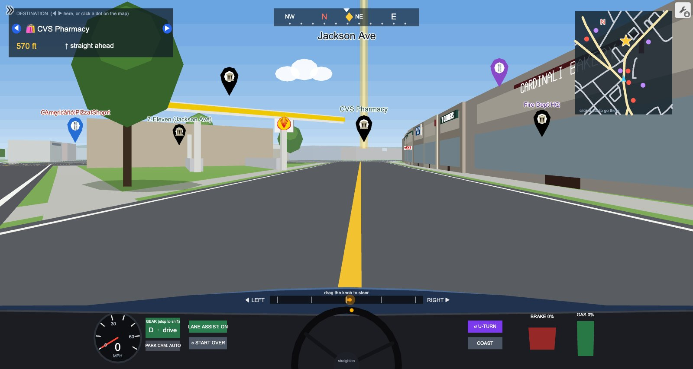

# Syosset Drive: a drivable 3D map of my hometown, built inside Desmos

**[Open the live demo: desmos.com/calculator/a2jxytiklu](https://www.desmos.com/calculator/a2jxytiklu)**


Syosset Drive is a first-person driving simulator of Syosset, New York that runs entirely inside the [Desmos](https://www.desmos.com/calculator) graphing calculator. There is no game engine and no code in the page beyond Desmos expressions. Every road, building, tree, parked car, sign, logo and letter is drawn by math expressions that Desmos re-evaluates on every tick, and this repository holds the code I used to generate and assemble them.

You can drive the real street network from OpenStreetMap, pull into the strip malls on Jericho Turnpike and see the actual storefronts with their logos, find restaurants, schools and civic buildings by name, read street signs at the corners, and practice parallel parking between parked cars.

## Try it

1. Open the demo link on a laptop or desktop (the graph is heavy, so a computer works best).
2. Click once inside the graph first. On some computers this keeps the browser from throttling it.
3. Tap **GAS** to speed up and **BRAKE** to slow down. Drag the knob at the bottom to steer.
4. Use the **GEAR** button (while stopped) to switch between drive and reverse.
5. Use **PARK CAM** for a top-down view. In its default AUTO setting it switches on by itself when you reverse.

The panel in the top-left shows your destination with its distance and direction. Use the arrows to pick one of 56 places (Chipotle, Starbucks, McDonald's, the LIRR station, the schools and more), or click a dot on the minimap to set it as your destination.

## What is in the world

| Feature | What is in it |
|---|---|
| Streets | 841 road lines from OpenStreetMap (about 215 km of road) with all 449 street names, in six road classes. This includes the Long Island Expressway, the Northern State Parkway, Route 135 and their ramps, the service roads and the LIRR line |
| Real buildings | 388 commercial, civic and school buildings placed on their real OpenStreetMap footprints, plus about 220 parking lots and three gas stations with canopies |
| Storefronts and logos | 82 logo signs for 34 brands, drawn as colored shapes: Chipotle, Starbucks, McDonald's, Dunkin', Burger King, Wendy's, Panera Bread, Domino's, CVS, 7-Eleven, Chase, Wells Fargo, The Home Depot, Lidl, Marshalls, HomeGoods, Shell, BP, AT&T and more. Chains with their own building also get a roadside pole sign |
| Local shops | 83 name signs on the fronts of local restaurants, shops and landmarks, from Cardinali Bakery on Jackson Avenue to Chris & Tony's on Jericho Turnpike |
| Houses and trees | 7,882 houses and 6,000 trees placed procedurally along the streets (they are not real house footprints) |
| Parked cars | 3,000 cars at the curb, about half of the available spots filled, with gaps left for parking |
| Street signs | 603 corner signs that show real street names |
| Landmarks | Schools, the library, post office, fire stations, hospital and the LIRR station, modeled as named buildings |

| Chipotle and Starbucks pole sign | McDonald's and 7-Eleven on Jericho Turnpike |
|---|---|
|  |  |

| Street signs | Parallel parking cam |
|---|---|
|  |  |



The LIRR station has a hanging "SYOSSET LIRR" sign, brick piers, a wooden soffit and the stained-glass sculpture next to it.


## How it works

**3D inside a 2D calculator.** Desmos only draws 2D shapes, so the graph does its own 3D. Each tick it takes the car's position and heading, transforms every nearby 3D point into camera space, applies a perspective divide, clips anything behind the camera, and draws the result as polygons. Faces are sorted from far to near (the painter's algorithm) so closer things cover farther ones.

**Real map data.** The street network, building footprints, parking lots and store locations come from OpenStreetMap. A small pipeline downloads the area, converts latitude and longitude to meters around the center of town, merges each divided highway's two one-way carriageways into a single wide road, connects side streets to the merged road, joins road pieces that continue each other, and simplifies the curves. Building outlines become oriented boxes. Any building that reaches into a road is trimmed back from the curb, and storefronts face the most important nearby road.

**Logos from shapes.** Every logo is built from filled polygons in a small library: circles, rounded rectangles, stars, Chipotle's pepper, McDonald's arches, the Shell pecten, and lettering made by thickening the stroke font into solid letters (including text that curves around a circle, like "MEXICAN GRILL"). The library holds about 7,600 points for 39 designs. Each tick the graph picks the three nearest logos you can actually see (pole signs win ties, so they show from farther away), places their points on the building or sign in 3D, projects them, and draws them as one list of polygons.

**Sky, haze and trees.** The sky is a 14-step gradient from pale haze at the horizon to deep blue overhead, and the horizon has three layers of hills and tree lines that get hazier the farther away they are. Buildings, trees, the grass and the roads all fade toward the same haze color with distance. Each tree has a sunlit crown on the side facing the sun and casts a soft shadow on the ground under it.

**Keeping it fast.** Desmos recomputes expressions constantly, so the cost of a frame is what matters most. Several techniques keep it playable:

- The town is split into grid cells, and each tick only looks at the objects in cells near the car instead of all 7,000+ houses, 3,000 cars and hundreds of stores. Store buildings, signs and decorations use the same grid, so only the ones within a few hundred meters are considered.
- Positions, heights and colors are packed into single integers and unpacked by expressions, which keeps the saved graph small (the world data is about 670 KB).
- Values that change every tick but rarely matter, such as which cell the car is in or which logos are nearest, are only written when they actually change, so they do not trigger everything that depends on them.
- Lists in Desmos are capped at 10,000 elements, so the cars, houses and road pieces are stored in per-cell lists that stay under the cap.
- Desmos pays a fixed cost for every expression it recomputes, so helper expressions that are only used once are folded into the expression that uses them.

**Driving model.** Speed responds to the gas and brake pedals, steering is a slider knob with smoothed turning, and a lane-assist option nudges the car toward the lane (it is looser in parking lanes). Reverse is a separate gear with its own speed cap.

**Collision and parking.** The car and each nearby parked car are oriented rectangles, and the graph tests them against each other every tick, checking the front and back of the car separately so you can still back out of contact. A cheap distance test runs first so only a few cars are checked at once. The parking cam shows the car from above with a live "gap to curb" number, and a "PARKED!" message appears when the car is straight, stopped and close to the curb.

**Text drawn from scratch.** Desmos cannot place arbitrary text in 3D, so I made a single-stroke font of 41 characters (A to Z, 0 to 9 and a few symbols) out of line segments. Street names and shop names are written as lines of these strokes and projected in 3D like everything else.

## Challenges along the way

- **Frame rate while turning.** Driving straight was smooth but turning dropped frames. The cause was work being redone for values that had not really changed, which I fixed by making the updates conditional.
- **The 10,000-element limit.** Adding parked cars pushed several lists over Desmos' limit and produced a wall of errors. I restructured the data into per-cell candidate lists.
- **Collision speed.** The first collision version checked every nearby block and the graph slowed to a few ticks per second. A distance prefilter brought it back to roughly 19 ticks per second on my laptop.
- **Cars in the wrong grid.** Parked cars first used the house grid, which was too coarse for them. Moving them to the finer road grid fixed the problem.
- **Fitting letters in the font.** Each glyph is limited to 14 points, so I had to redraw the 3 and 8 to stay under the limit.
- **Shadows that cost too much.** The first tree shadows projected all eight corners of every shadow into 3D and slowed the graph by about 6%. Projecting only each shadow's center and scaling a fixed octagon looks the same and costs almost nothing.
- **Freezing after a few minutes.** After a few minutes of driving, the graph would stall for seconds at a time. Desmos turns list math into JavaScript functions and writes long decimals (like the sine of the car's heading) straight into their code, so every tick produced hundreds of new functions and the browser's memory ballooned. Rounding the car's position and heading to six decimals in the ticker, computing the heading's sine and cosine there, and finding the nearest road with a sort instead of comparing against a moving minimum lets Desmos reuse the same compiled code every tick, and memory stays flat.
- **Traced roads were off.** The first street network was traced from map screenshots, so some roads were bent, shifted or missing, and about half the side streets had no names. Switching to OpenStreetMap fixed the shapes and positions, added the missing roads (including the highways and their ramps) and named every street. The extra names did not fit the old packing (which allowed 255 names), so the road data now stores up to 1,023.
- **Highways drawn twice.** OpenStreetMap draws each direction of a divided highway as its own road, which looked like two highways side by side. The converter pairs up the two directions and replaces them with one wide road down the middle.
- **Restaurants on the sidewalk.** The original restaurant landmarks were placed as their own buildings, and once the real strip malls arrived they got pushed out onto the sidewalk. Restaurants that fall inside a real building now become a storefront sign on that building instead.
- **More destinations than the slider allowed.** The destination picker was a slider capped at 33, so the new places past number 33 were unreachable until the cap was raised to match the list.

## Repository layout

```
src/
  world5.js       generates the world from OpenStreetMap data: roads, real store buildings,
                  storefront signs and logos, pole signs, gas stations, parking lots, houses,
                  trees, parked cars, street signs and landmarks
  logos.js        the logo library: every brand logo built from filled polygons
  pack4.js        packs the world into compact integers (writes data/syo_data4.json)
  patch13.js      in-browser builder: swaps the new map, stores and logos into the saved graph
  font.js         the single-stroke font used for street and shop names
  world4.js, pack3.js, patch9.js ... patch12.js
                  the earlier pipeline (traced streets) and the feature patches that built the
                  driving engine, parked cars, parking cam, street signs, graphics and the freeze fix
data/
  osm_lines.json     street network from OpenStreetMap (names, road class, points in meters)
  osm_rail.json      LIRR line from OpenStreetMap
  osm_pois.json      store buildings, tenants, parking lots and gas stations from OpenStreetMap
  syo_data4.json     packed world data produced by pack4.js
  final_lines.json, final_rail.json, syo_data3.json
                     the earlier traced street network and its packed data
tools/osm/
  fetch.sh        downloads the Syosset area from the OpenStreetMap API in 25 tiles
  parse.py        turns the downloaded tiles into roads, rail, places and areas
  roads.mjs       converts roads and rail into the sim's format (merges divided highways)
  pois.mjs        extracts store buildings, tenants, parking lots and gas stations
  obb.mjs         oriented bounding boxes for building outlines
  preview.mjs     renders the road network to an image for checking
  logoprev.mjs    renders the logo library to an image for checking
tools/apply13.mjs    applies patch13.js to a saved graph state in a headless browser
tools/map-extraction/   the older Python scripts for tracing streets from map images
docs/images/            screenshots used above
```

To rebuild the map from OpenStreetMap:

```
sh tools/osm/fetch.sh osm-tiles
python3 tools/osm/parse.py osm-tiles osm.json
node tools/osm/roads.mjs osm.json data/osm_lines.json data/osm_rail.json
node tools/osm/pois.mjs osm.json data/osm_pois.json
node src/pack4.js
```

The random seed is fixed, so the same OpenStreetMap download always produces the same world. `patch13.js` runs on the saved graph: open it, paste the script into the browser console, and run `Calc.setState(__build13(Calc.getState(), D).S)` with `D` set to the contents of `data/syo_data4.json`. `tools/apply13.mjs` does the same in a headless browser (it needs Playwright). The live demo already includes it.

The camera, dashboard and driving engine live in the saved graph rather than in this repository, so the live demo is the complete working version and the code here documents how the world and the later features were built.

## Limits

- Only the three nearest logos, the two nearest shop signs and the two nearest street signs are drawn at any moment, to stay within Desmos' speed limits.
- Houses are generated, not real house footprints, and the cars, the station and the other landmarks are simplified blocky models.
- Store data is only as current as OpenStreetMap, so a few stores may have closed or moved.
- Reverse tops out around 15 mph.
- Performance depends on the computer. Desmos slows down in background tabs and on slower machines.

## Credits and data

- Map data © [OpenStreetMap](https://www.openstreetmap.org/copyright) contributors, available under the [Open Database License](https://opendatacommons.org/licenses/odbl/). The streets, rail line, building footprints, parking lots and store locations all come from OpenStreetMap.
- Landmark names and coordinates for the schools, civic buildings and local restaurants come from Google Maps.
- Store names and logos are trademarks of their owners. The logos here are simplified drawings made for this hobby project, which is not affiliated with any of these companies.
- Built on the [Desmos Graphing Calculator](https://www.desmos.com/calculator). This project is not affiliated with Desmos, Google, OpenStreetMap or the Long Island Rail Road.

## License

The code in this repository is released under the MIT License (see `LICENSE`). The OpenStreetMap-derived data (`data/osm_*.json` and `data/syo_data4.json`) is available under the Open Database License, © OpenStreetMap contributors. The earlier traced data in `data/` comes from third-party imagery and is included for documentation of this project only.

Built by Kenneth Shi.
