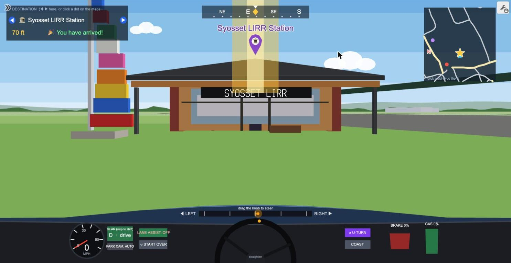
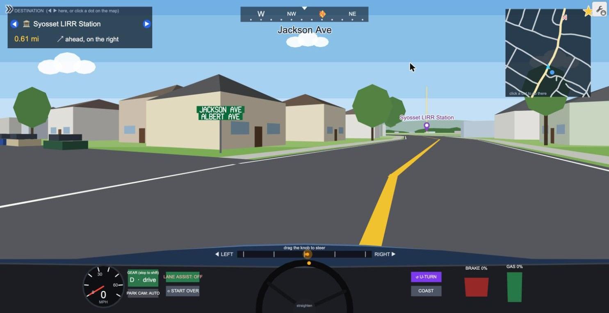
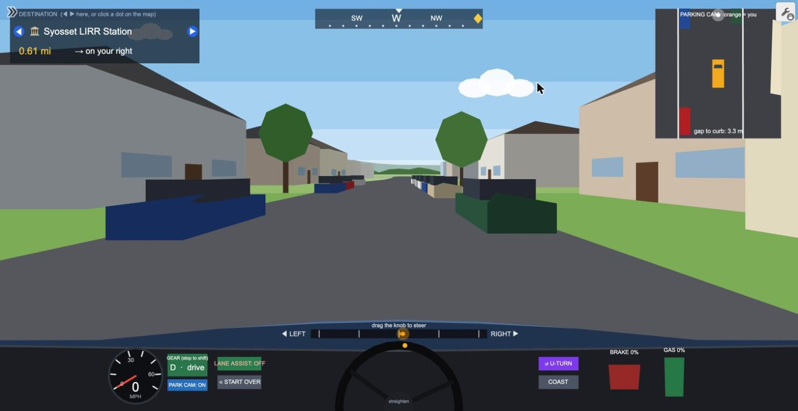

# Syosset Drive: a drivable 3D map of my hometown, built inside Desmos

**[Open the live demo: desmos.com/calculator/a2jxytiklu](https://www.desmos.com/calculator/a2jxytiklu)**



Syosset Drive is a first-person driving simulator of Syosset, New York that runs entirely inside the [Desmos](https://www.desmos.com/calculator) graphing calculator. There is no game engine and no code in the page beyond Desmos expressions. Every road, house, tree, parked car, sign and letter is drawn by math expressions that Desmos re-evaluates on every tick, and this repository holds the code I used to generate and assemble them.

You can drive around the real street layout, find restaurants, schools and civic buildings by name, read street signs at the corners, and practice parallel parking between parked cars.

## Try it

1. Open the demo link on a laptop or desktop (the graph is heavy, so a computer works best).
2. Click once inside the graph first. On some computers this keeps the browser from throttling it.
3. Hold **GAS** to go and **BRAKE** to stop. Drag the knob at the bottom to steer.
4. Use the **GEAR** button (while stopped) to switch between drive and reverse.
5. Use **PARK CAM** for a top-down view. In its default AUTO setting it switches on by itself when you reverse.

The panel in the top-left shows your destination with its distance and direction. Use the arrows to pick a different place, or click a dot on the minimap to set it as your destination.

## What is in the world

| | |
|---|---|
| Streets | 349 named road lines traced from map imagery (243 distinct street names), in six road classes, with a parking lane beside the travel lanes |
| Houses and trees | 7,869 houses and 6,000 trees placed procedurally along the streets (they are not real building footprints) |
| Parked cars | 3,000 cars at the curb, about half of the available spots filled, with gaps left for parking |
| Street signs | 436 corner signs that show real street names |
| Landmarks | 34 named places placed at their real coordinates: restaurants, schools, the library, post office, fire stations, hospital, LIRR station and more |

Landmarks are modeled as buildings with a name sign on the front. The LIRR station has a hanging "SYOSSET LIRR" sign, brick piers, a wooden soffit and the stained-glass sculpture next to it.

| Street signs | Parallel parking cam |
|---|---|
|  |  |

## How it works

**3D inside a 2D calculator.** Desmos only draws 2D shapes, so the graph does its own 3D. Each tick it takes the car's position and heading, transforms every nearby 3D point into camera space, applies a perspective divide, clips anything behind the camera, and draws the result as polygons. Faces are sorted from far to near (the painter's algorithm) so closer things cover farther ones.

**Keeping it fast.** Desmos recomputes expressions constantly, so the cost of a frame is what matters most. Several techniques keep it playable:

- The town is split into grid cells, and each tick only looks at the objects in cells near the car instead of all 7,000+ houses and 3,000 cars.
- Positions, heights and colors are packed into single integers and unpacked by expressions, which keeps the saved graph small (the world data is about 450 KB).
- Values that change every tick but rarely matter, such as which cell the car is in, are only written when they actually change, so they do not trigger everything that depends on them.
- Lists in Desmos are capped at 10,000 elements, so the cars, houses and road pieces are stored in per-cell lists that stay under the cap.

**Driving model.** Speed responds to the gas and brake pedals, steering is a slider knob with smoothed turning, and a lane-assist option nudges the car toward the lane (it is looser in parking lanes). Reverse is a separate gear with its own speed cap.

**Collision and parking.** The car and each nearby parked car are oriented rectangles, and the graph tests them against each other every tick, checking the front and back of the car separately so you can still back out of contact. A cheap distance test runs first so only a few cars are checked at once. The parking cam shows the car from above with a live "gap to curb" number, and a "PARKED!" message appears when the car is straight, stopped and close to the curb.

**Text drawn from scratch.** Desmos cannot place arbitrary text in 3D, so I made a single-stroke font of 41 characters (A to Z, 0 to 9 and a few symbols) out of line segments. Street names and building names are written as lines of these strokes and projected in 3D like everything else.

## Challenges along the way

- **Frame rate while turning.** Driving straight was smooth but turning dropped frames. The cause was work being redone for values that had not really changed, which I fixed by making the updates conditional.
- **The 10,000-element limit.** Adding parked cars pushed several lists over Desmos' limit and produced a wall of errors. I restructured the data into per-cell candidate lists.
- **Collision speed.** The first collision version checked every nearby block and the graph slowed to a few ticks per second. A distance prefilter brought it back to roughly 19 ticks per second on my laptop.
- **Cars in the wrong grid.** Parked cars first used the house grid, which was too coarse for them. Moving them to the finer road grid fixed the problem.
- **Fitting letters in the font.** Each glyph is limited to 14 points, so I had to redraw the 3 and 8 to stay under the limit.

## Repository layout

```
src/
  world4.js       generates the world: roads, houses, trees, parked cars, signs, landmarks
  pack3.js        packs the world into compact integers (writes data/syo_data3.json)
  font.js         the single-stroke font used for street and building names
  patch9.js       in-browser builder: world data into Desmos expressions
  patch10.js      in-browser builder: wide streets, parked cars, collision, reverse gear,
                  parking cam, street signs and facade signs
data/
  final_lines.json   street network (names, road class, points in meters)
  final_rail.json    LIRR line
  syo_data3.json     packed world data produced by pack3.js
tools/map-extraction/   Python scripts for turning map images into the street network
docs/images/            screenshots used above
```

To regenerate the packed world data (the random seed is fixed, so the output is identical every time):

```
node src/pack3.js
```

The patch scripts run in the browser console on a Desmos page and add their expressions to a base graph state (the camera, dashboard and driving engine). That base state lives in the saved graph rather than in this repository, so the live demo is the complete working version and the code here documents how the world and the later features were built.

## Limits

- Only the two nearest street signs and two nearest named buildings carry lettering at any moment, to stay within Desmos' speed limits.
- Cars, the station and the other landmarks are simplified blocky models.
- About half of the side streets are unnamed on Google Maps, so some corners show one name or no sign.
- Reverse tops out around 15 mph.
- Performance depends on the computer. Desmos slows down in background tabs and on slower machines.

## Credits and data

- Street layout was traced from Google Maps imagery, and landmark names and coordinates come from Google Maps. The imagery itself is not included in this repository. Google Maps content belongs to Google and its data providers.
- Built on the [Desmos Graphing Calculator](https://www.desmos.com/calculator). This project is not affiliated with Desmos, Google or the Long Island Rail Road.
- Houses, trees and parked cars are generated, so they do not match real buildings or real parked cars.

## License

The code in this repository is released under the MIT License (see `LICENSE`). Map-derived data in `data/` comes from third-party imagery and is included for documentation of this project only.

Built by Kenneth Shi.
