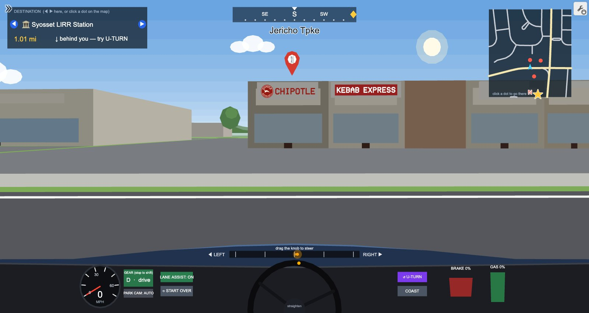
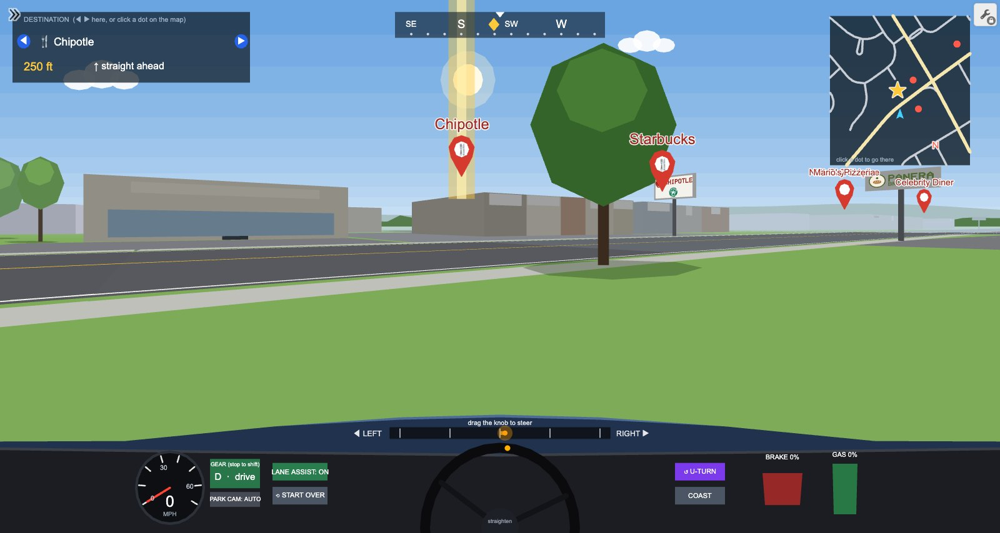
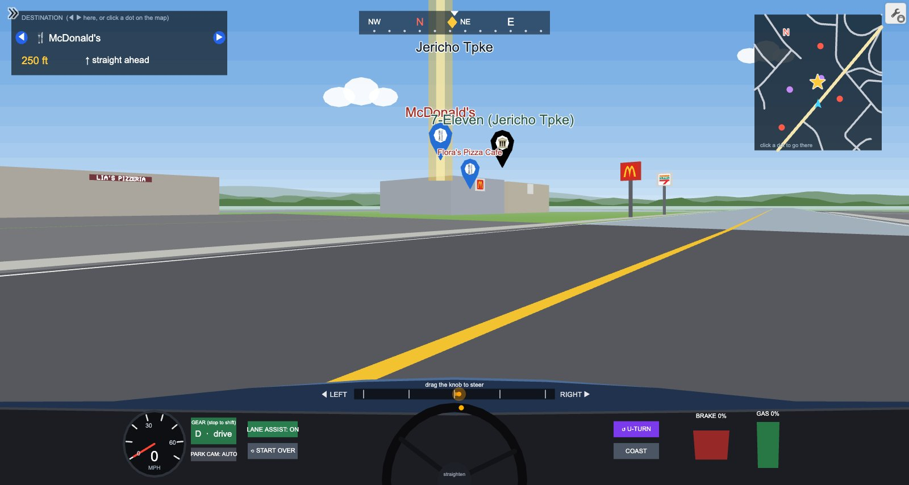

# Syosset Drive

A drivable 3D map of Syosset, New York, built entirely inside the Desmos graphing calculator. The streets come from OpenStreetMap, and you can drive down Jericho Turnpike, pull into the strip malls and see the real stores with their logos, read the street signs, and practice parallel parking.

**Play it:** https://www.desmos.com/calculator/a2jxytiklu



## Controls

Use a laptop or desktop, since the graph is heavy. Click once inside the graph first, which keeps some browsers from slowing it down.

- **GAS** and **BRAKE** to speed up and slow down, and drag the knob at the bottom to steer
- **GEAR** (while stopped) switches between drive and reverse
- **PARK CAM** gives a top-down view, and turns on by itself when you reverse
- The panel at the top left points you to a destination. Pick one of 56 places with the arrows, or click a dot on the minimap.

## What's in it

- 841 real roads from OpenStreetMap with all 449 street names, including the LIE, the Northern State Parkway, Route 135 and the LIRR line
- 388 stores, schools and civic buildings on their real footprints, plus parking lots and gas stations
- 82 logo signs for 34 brands (Chipotle, Starbucks, McDonald's, Dunkin', CVS and more) and 83 name signs on local shops
- 603 street signs at the corners
- About 7,900 houses, 6,000 trees and 3,000 parked cars placed along the streets (these are generated, not real footprints)
- The LIRR station, the library, the schools and other landmarks

| Pole sign at the plaza | McDonald's and 7-Eleven on Jericho Turnpike |
|---|---|
|  |  |

| Street signs | Parking cam |
|---|---|
|  |  |


## How it works

Desmos only draws 2D shapes, so the 3D is done by hand. Each tick the graph moves every nearby point into the camera's view, divides by depth, clips anything behind the camera, and draws faces far to near.

The map data comes from OpenStreetMap. A small pipeline downloads the area, converts coordinates to meters, merges the two directions of divided highways into one road, and turns building outlines into boxes facing the nearest main road. Logos are built from filled polygons, and text is drawn with a custom single-stroke font, since Desmos can't place text in 3D.

To keep it fast, the town is split into grid cells and each tick only looks at objects near the car. World data is packed into integers to keep the saved graph small, and values like the current cell only update when they actually change. Desmos lists max out at 10,000 items, so cars, houses and roads are stored in smaller per-cell lists.

A few problems along the way:

- Turning used to drop frames, because values that hadn't really changed were being recomputed.
- Adding parked cars pushed lists past the 10,000 limit, so the data had to be split by cell.
- The graph froze after a few minutes of driving. Desmos writes long decimals straight into the code it compiles, so the car's constantly changing heading created new functions every tick. Rounding per-tick values fixed it.
- The first street map was traced from screenshots and had bent or missing roads. Switching to OpenStreetMap fixed the shapes and named every street.

## Building it

```
sh tools/osm/fetch.sh osm-tiles
python3 tools/osm/parse.py osm-tiles osm.json
node tools/osm/roads.mjs osm.json data/osm_lines.json data/osm_rail.json
node tools/osm/pois.mjs osm.json data/osm_pois.json
node src/pack4.js
```

`src/world5.js` builds the world, `src/logos.js` has the logos, and `src/patch13.js` loads the new map into the saved graph (`tools/apply13.mjs` does it in a headless browser with Playwright). The camera, dashboard and driving engine live in the saved graph itself, so the live link is the complete version.

## Limits

- Only the nearest few logos, shop signs and street signs are drawn at once.
- Houses, cars and landmarks are simplified blocky models.
- Stores are only as current as OpenStreetMap.
- It runs slower on older computers and in background tabs.

## Credits

- Map data © [OpenStreetMap](https://www.openstreetmap.org/copyright) contributors, available under the [Open Database License](https://opendatacommons.org/licenses/odbl/).
- Landmark names and coordinates for schools, civic buildings and local restaurants come from Google Maps.
- Store names and logos belong to their owners. The logos here are simplified drawings for a hobby project, not affiliated with any of these companies, Desmos, Google, OpenStreetMap or the LIRR.

Code is MIT licensed (see `LICENSE`). The OpenStreetMap-derived data (`data/osm_*.json` and `data/syo_data4.json`) is under the Open Database License, © OpenStreetMap contributors. The earlier traced data in `data/` comes from third-party imagery and is included only to document the project.

Built by Kenneth Shi.
